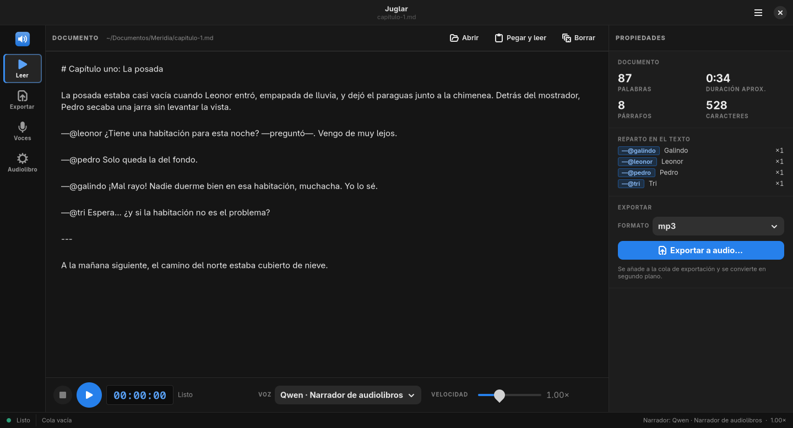
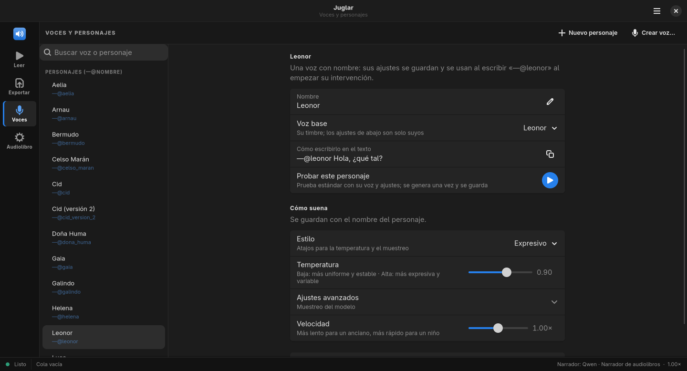
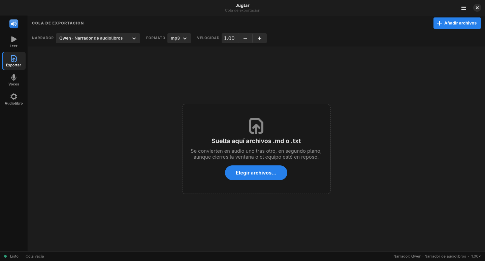

# Juglar

**Lee textos en voz alta y convierte tus libros en audiolibros, con una voz distinta para cada personaje. Todo en tu ordenador, sin internet y en español.**

Los juglares iban de pueblo en pueblo contando historias y dando voz a cada personaje. Juglar hace lo mismo con tus textos en Markdown: un narrador cuenta la historia y, cuando habla un personaje, se oye su propia voz.



## Qué hace

- **Leer en voz alta** cualquier texto o archivo `.md`/`.txt`, con pausa, código de tiempo y control de velocidad.
- **Audiolibros con reparto**: el narrador lee la historia y cada diálogo lo dice la voz de su personaje (`—@leonor ¿Tienes miedo?`).
- **Más de 50 voces** de Qwen3-TTS incluidas (narradores, personajes, voces de pueblo…), más voces rápidas de Piper y Kokoro.
- **Crea voces nuevas** describiéndolas con palabras: «anciano de 80 años, voz ronca y temblorosa, gruñón».
- **Personajes con nombre**, cada uno con su voz base, su temperatura y su velocidad.
- **Cola de exportación** a MP3, OGG, M4B (con capítulos) o WAV, que sigue trabajando en segundo plano aunque cierres la ventana o el equipo esté en reposo.
- **Calidad de audiolibro**:
  - cifras, fechas, números romanos y abreviaturas leídos como palabras;
  - pausas configurables y cambios de escena;
  - volumen igualado a −19 LUFS;
  - revisión automática con Whisper, que regenera los fragmentos mal leídos.
- **Diccionario de pronunciación** para nombres inventados o extranjeros.

| Voces y personajes | Cola de exportación |
|---|---|
|  |  |

## Requisitos

- **Linux** con GTK 4 y libadwaita 1.7 o posterior (probado en Fedora 43 con GNOME).
- **Python 3** del sistema con PyGObject, `ffmpeg`, `aplay` (alsa-utils) y `curl`.
- Para las voces de **Qwen3-TTS**, que son las de mejor calidad: una tarjeta **NVIDIA con unos 8 GB** de memoria (probado con una RTX 4060 Laptop) y unos **15 GB** de disco para modelos y entornos.
- Sin GPU funcionan las voces de Piper y Kokoro (ver `SIN_QWEN` abajo).

## Instalación

```bash
git clone git@github.com:YeisenK/Juglar.git
cd Juglar
./install.sh
```

El instalador:

1. Comprueba los paquetes del sistema y te dice qué instalar si falta algo. En Fedora: `sudo dnf install ffmpeg alsa-utils curl python3-gobject gtk4 libadwaita`.
2. Instala [`uv`](https://docs.astral.sh/uv/) si no lo tienes y crea tres entornos de Python en `~/.local/share/juglar`: Piper/Kokoro, Qwen3-TTS y Whisper.
3. Descarga las voces de Piper, el modelo de Kokoro y los modelos de Qwen3-TTS y Whisper (unos 9 GB la primera vez).
4. Copia las voces incluidas, crea los comandos en `~/.local/bin` y añade Juglar al menú de aplicaciones.

Sin tarjeta NVIDIA, instala solo las voces rápidas:

```bash
SIN_QWEN=1 ./install.sh
```

Se puede volver a ejecutar cuando quieras (por ejemplo, tras un `git pull`): lo que ya está instalado se deja como está.

## Uso

Abre **Juglar** desde el menú de aplicaciones o escribe `juglar`. La app tiene cuatro pestañas:

| Pestaña | Para qué |
|---|---|
| **Leer** | Escribir, pegar o abrir un texto y escucharlo. A la derecha, *Propiedades*: duración estimada, quién habla en el texto y **Exportar a audio…** |
| **Exportar** | La cola de conversión: arrastra archivos o pulsa *Añadir archivos*. Elige narrador, formato y velocidad. |
| **Voces** | Escuchar cada voz o personaje (*Probar*), ajustar su temperatura, crear personajes con nombre y voces nuevas. |
| **Audiolibro** | Pausas, voz de los diálogos, revisión con Whisper, volumen y diccionario de pronunciación. |

Atajos: `Ctrl+Intro` leer/pausar · `Esc` detener · `Ctrl+O` abrir y leer · `Ctrl+Mayús+E` exportar · `Ctrl+1…4` cambiar de pestaña.

### Cómo escribir tus textos

La guía completa está en **[docs/GUIA.md](docs/GUIA.md)**: qué marcas usar, qué convierte solo, la lista de voces y un ejemplo de capítulo. Lo esencial:

```markdown
# Capítulo uno

La posada estaba casi vacía cuando Leonor entró.

—@leonor ¿Tiene una habitación? —preguntó—. Vengo de muy lejos.

—@pedro Solo queda la del fondo.

---

A la mañana siguiente, el camino estaba cubierto de nieve.
```

- `#` es un título y un capítulo del audio. Una línea en blanco separa los párrafos. `---` marca un cambio de escena (pausa larga).
- Un párrafo que empieza con **raya (—)** es un diálogo. `—@nombre` lo dice ese personaje, `—2` la voz número 2 y una raya sin marca usa la voz de los diálogos.

### Desde la terminal

| Comando | Qué hace |
|---|---|
| `juglar` | Abre la app. `juglar --leer capitulo.md` lo lee en voz alta ya. `juglar capitulo.md` lo añade a la cola. |
| `leer "texto"` / `leer capitulo.md` | Lee en voz alta sin abrir la ventana. `leer -v qwen:narrador -s 1.1 …` |
| `md2audio capitulo.md -o capitulo.mp3 -v qwen:narradora` | Convierte a audio. `--text-only` muestra el texto tal como se va a leer. `--list-voices` lista las voces. `--help` muestra todo lo demás. |
| `juglar-cola add *.md` · `list` · `pause` · `resume` | Maneja la cola de exportación. |
| `juglar-pruebas` | Genera de una vez las pruebas de voz que falten. |

## Dónde se guarda cada cosa

| Ruta | Contenido |
|---|---|
| Este repositorio | El código (`juglar/`, `motores/`), las voces incluidas (`voces/`) y la documentación. |
| `~/.local/share/juglar/` | Entornos de Python, modelos, **tus voces**, personajes (`voces/elenco.json`), ajustes del audiolibro y pruebas de voz. Se puede cambiar con `JUGLAR_DATA`. |
| `~/.config/juglar/` | Ajustes de la ventana, `pronunciacion.txt` y `prueba_voz.txt`. |
| `~/.local/state/juglar/cola/` | El estado de la cola de exportación. |
| `~/.cache/juglar/` | Registros (`qwen.log`, `revision.log`). |

## Estructura del proyecto

```
juglar/      app.py (interfaz GTK), md2audio.py (texto → audio), cola.py (cola en segundo plano),
             texto_es.py (cifras, fechas, diálogos), pruebas.py, rutas.py, estilo.css
motores/     qwen_worker.py, whisper_worker.py, crear_voz.py, recortar_referencias.py
voces/       voces de Qwen incluidas (grabación de referencia + descripción)
bin/         comandos: juglar, leer, md2audio, juglar-cola, juglar-pruebas
data/        lanzadores de escritorio e icono
docs/        guía de escritura y capturas
```

## Problemas frecuentes

- **Qwen tarda en empezar a leer.** La primera frase llega a los 10–15 s porque carga el modelo en la GPU. Si hay otra app usando la tarjeta, puede tardar mucho más.
- **«La GPU no tiene memoria libre para Qwen».** Cierra otros programas que usen la tarjeta (otro modelo de IA, juegos…). Una conversión en la cola también la ocupa.
- **Una voz pronuncia mal un nombre.** Añádelo al diccionario (pestaña *Audiolibro* → *Diccionario de pronunciación*).
- **Algo falló en una conversión.** Mira `~/.cache/juglar/qwen.log` y `~/.local/state/juglar/cola/cola.log`.

## Créditos

Juglar se apoya en estos proyectos, que el instalador descarga desde sus fuentes. Cada uno conserva su propia licencia:

- [Qwen3-TTS](https://github.com/QwenLM/Qwen3-TTS) (Alibaba Qwen) para las voces principales y la creación de voces.
- [Piper](https://github.com/OHF-Voice/piper1-gpl) y sus [voces](https://huggingface.co/rhasspy/piper-voices).
- [Kokoro-82M](https://huggingface.co/hexgrad/Kokoro-82M) mediante [kokoro-onnx](https://github.com/thewh1teagle/kokoro-onnx).
- [faster-whisper](https://github.com/SYSTRAN/faster-whisper) para la revisión automática.
- GTK 4 y libadwaita para la interfaz.

Las voces de `voces/` son sintéticas, creadas con Qwen3-TTS VoiceDesign a partir de descripciones de texto.

## Licencia

[MIT](LICENSE) © 2026 YeisenK
